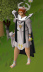
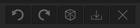
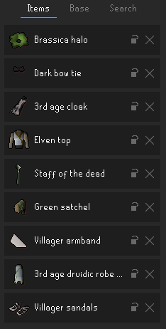
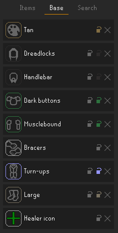
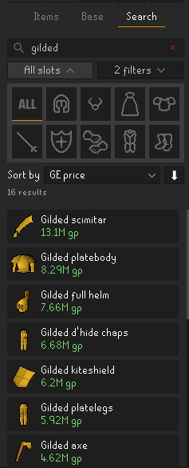

# Fashionscape

RuneLite plugin that enables cosmetic changes to your character's equipped items, base models, colours, and more. Other
players can't see the changes this plugin makes; the intention is to provide a tool for players to preview what
different combinations of models look like on them.

***Disclaimer:*** This plugin isn't intended to be on all the time. Use at your own risk in dangerous areas of the game.
Your animations may only be correct while your character is idle.

## Update 2026 October part two: search filters

The search tab now supports **filters**, so you can narrow results down by more than just slots.

* Two buttons under the search bar expand or collapse the **slots** and **filters** sections.
* Filters include f2p/members, whether the item has combat stats, tradeability (on the GE), and value (GE price or
  high alch, with a min/max range). Filters are saved between sessions.
* There's a new **"GE price"** sort option, which shows each item's price.
* The "all" slot now shows results for an empty search, as long as there aren't too many of them. Results also show
  how many items match your query + filters.
* "Exclude members items" now only affects the randomizer. Search uses the "membership" filter instead. If you had the
  setting on, the filter starts on F2P.
* The jaw icon slot in the "base" tab is always available now.

See the [changelog](https://github.com/equirs/fashionscape-plugin/blob/master/CHANGELOG.md) for earlier updates.

## User guide

All the UI lives in a dedicated side panel. If the plugin is on, you'll find it near the bottom of the list (beneath
notes). Look for the dress form:

The panel has a row of button controls, and below it, three tabs: items, base, and search.

#### Top controls

The buttons are, in order from left to right:

* Undo and redo last action (these are only enabled if you can perform them)
* A randomizer button that randomly assigns models to all your unlocked slots. The randomizer has an
  "intelligence" setting in the plugin config, which, when set to anything other than `NONE`, will utilize the colour
  matching algorithm to promote a more cohesive look.
* A loadouts button, which opens your saved loadouts over the tabs (see "Loadouts" below). It stays
  highlighted while the view is open.
* Clear button, which undoes everything you're wearing with the plugin, **including** locked slots. If you want to erase
  everything *except* locked slots, there's a right-click option to soft clear.

#### Items tab

"Items" shows every item you're wearing via the plugin. Note that certain slots, like ammo, are not shown because no
items equipped in those slots change your appearance. Each item shows an icon that can be clicked to bring up a search
for new items in that slot. You can also "lock" and clear out each slot with the controls on the right (see
"lock mechanics" for more on locks). If nothing is set in a slot, it will display **"Not set"**, and you will see
whatever your character is actually wearing in-game. If you'd like to override what you're wearing to display nothing,
this is possible by selecting **"Nothing"** in the search results (note: this is only possible for certain item slots).

#### Base tab

"Base" is similar to "items", only this tab allows changing your character's base models and colours, essentially
combining every makeover NPC into one. The icons in this tab have a rounded border indicating the colour you've swapped
to (if you haven't changed the colour, it will show up as light gray). Note that torso+arms and hair+jaw slot colours
are connected, so changing one always changes the other. There is no search feature for these slots since there aren't
as many options; instead, **clicking the icon** brings up a dropdown to browse the colour/model options available. Also,
if you're seeing that the plugin is failing to fetch, you may **right-click the icon** to set the model to "nothing"
(this is intentionally obscure since you'll only need to do this if the plugin's requests are failing). Right-clicking
the icon a second time will toggle the model back to "not set".

There is also an option to change your character's icon (the ones used in Barbarian Assault and Soul Wars).
While these are technically items, their mechanics function more like base models, and the UI for this slot works
like all the others in "base".

#### Search tab

Here you can search for equipment to try on (by name or by [item ID](https://oldschool.runescape.wiki/w/Item_IDs)).
The results will update as you type.

The two buttons under the search bar show and hide the **slots** and **filters** sections. The slots button shows
which slot you're browsing. The filters button shows how many filters are active.

* Slots: pick an equipment slot, or "all" to search every slot. Locked slots show a lock badge.
* Filters: membership, has combat stats, tradeable (on the Grand Exchange), and value. For GE price or high alch
  value, enter a min and/or max, such as `10k` or `1.5m`. "Reset filters" sets every filter back to "any".
  Filters are saved between sessions.

Leaving the search bar empty shows every result for the selected slot. In "all", results aren't shown if there would
be more items than the max shown for any single slot, in which case it asks you to narrow the search. Searching an
exact item ID always shows that item, regardless of slot / filters. Hovering over an item will show a preview of what
it looks like on your character. When clicked, the item will update and will display as part of your outfit. If the
item is already worn, clicking it again removes it. If you have locks enabled, the result text will appear grey instead
of white, and hovering over the result shows a tooltip indicating which locked slots are preventing you from equipping
the item.

There are four sorting options:

* Default, which roughly orders results by release date (it actually just goes by item IDs; close enough)
* Alphabetical, pretty self-explanatory
* GE price, most valuable first. Prices are shown for each result where available.
* Colour match, which uses aggregated, area-weighted Euclidean colour distances of the "best-matching" colours for that
  result compared to the colours of all the items currently worn (excluding the slot you're currently browsing). With
  this option selected, you can also see the colour-coded percent match for that item.

#### Loadouts

Changes you make within the plugin can be stored as loadouts. These are saved to your RuneLite config.

* "+" saves your current look as a new loadout.
* Click a loadout to apply it. Applying clears your locks. Like other changes, you can undo applying a loadout.
* The arrows and "x" in the top right reorder and delete loadouts. Reordering is only an option in "Custom"
  sort.
* **Right-click** a loadout to update it with your current look, rename it, or copy it to the clipboard.
* "Load current equipment" imports whatever you're wearing in-game.
* The "..." menu imports loadouts from the clipboard or from files, and can export all of them to one file. Imports
  accept both the new format and the legacy .txt format.

Each loadout shows some item icons, or base model names if it contains no items. A bar along the bottom shows any
colours you've set. Base models saved on a differently-gendered character are converted when they're applied.

#### Lock mechanics

You can "lock" individual slots with the lock icon next to the x button for each slot in the "items" and "base" panels
(some base slots have two locks: model and colour, in that order, with the colour lock matching the current slot
colour). This prevents that slot from being cleared by the randomizer and the undo/redo function. Clicking the lock
again will unlock it. The locking feature is designed to work with the randomizer: as you find pieces that work
together, you can lock them and randomize the remaining slots. Note that locking a base model will always lock the
corresponding item slot, and unlocking an item slot will always unlock the base model. However, you can be in a state
where the item slot is locked while the base slot is unlocked.

  
Neat things you can do with locks:

* Lock the shield slot and randomize with weapons unlocked. All weapon results will be one-handed.
* Lock your player's hair/beard with the head item unlocked and randomize. All the head slot results will not obscure
  your hair and/or beard. A similar approach can be used on the player's arms model and the torso item slot.
* Lock the empty torso, legs, and/or boots item slots while leaving the base models unlocked. The randomizer will now
  scramble your base models for those slots.

#### Configuration

There is a right-click option to **"copy-fashion"** on other players, which imports their entire look on your character,
including items, colours, and (if your genders match) base models. Since many other plugins provide player menu entries,
this feature can be toggled off.

The randomizer has a few **"intelligence"** settings. Higher intelligence means the randomizer results will yield items
that are similar in colour. Lower intelligence settings are computationally faster. "Cursed" attempts to create the most
mismatched results in terms of colour scoring.

To randomize only free-to-play items, turn on **"exclude members items"** in the randomizer settings. To search only
free-to-play items, use the membership filter in the search tab.

## FAQ

Q: Isn't this hacking? Am I gonna get banned?

A: Again, other players can not see your outfits, and nothing is being sent to the server via this plugin. Using it is
not functionally affecting the game, so it's no different from other purely aesthetic plugins like resource packs.

Q: Why is it changing my character's arms / (facial) hair?

A: The client has no way of telling what your character's base models look like unless you reveal them, so it's using
some default models. The easiest fix is to un-equip your head- and torso-slot items once. You can re-equip your items
after doing this, and after you've done it once on your account, it shouldn't happen again.

Q: My animations mess up when I equip (...). Why?

Idle animations are currently the only scenario supported for now (after all, real fashionscapers are usually idle). If
you want to transmog your weapons and run around with them, I highly recommend trying out
the [weapon animation replacer](https://github.com/geheur/weapon-animation-replacer), which is also available on the
RuneLite plugin hub.

Q: Such-and-such item isn't showing up or looks janky, why?

If you notice some items look buggy or don't have the correct idle animation, please let me know by filing an issue
(note that I may take some time after a game update to fix my own data).

Feature suggestions, bug reports, and pull requests are all welcome. Please keep in mind that this plugin is intended to
be a tool for discovery and planning, and features that extend beyond that will probably not be implemented.
